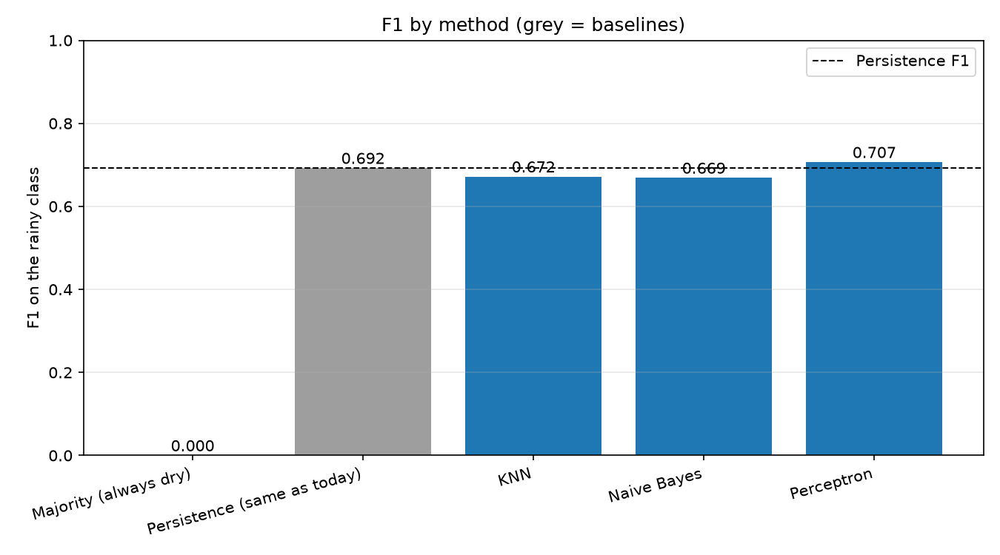
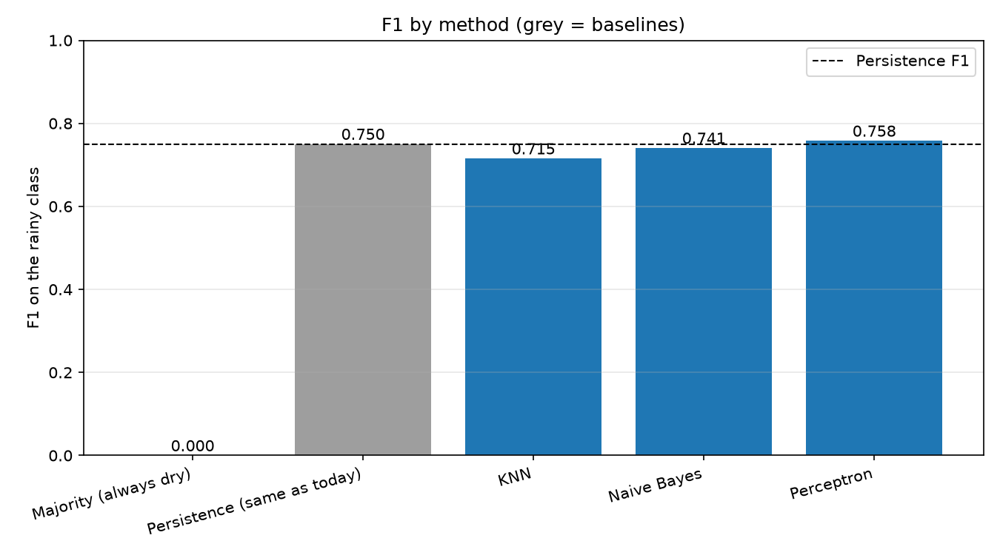

🌧️ **Project Website:** https://szhan17.github.io/cmsc170-project/

# RAIN RAIN GO AWAY OR GO HERE

CMSC 170 AI Project. From today's weather in Los Baños, predict whether tomorrow will have at least 5 mm of rain, and compare three methods written from scratch: K-Nearest Neighbors, Naive Bayes and the Perceptron.

**Group:** FEBS

**Members:** Enzo Joyosa, Franz Jeremy Ellao, Brylle Pamulaklakin, Szhan Wayne Timosan

## Setup (first time only)

```bat
python -m venv .venv
.venv\Scripts\pip install numpy matplotlib
```

Only the Python standard library, NumPy and Matplotlib are allowed. Pandas, scikit-learn and any library that implements the methods are not.

## Running

Run these from the project root. Each method trains on 2001-2017 and prints accuracy, precision, recall, F1 and the confusion matrix for the validation years (2018-2021). Only `python src/run.py --final` uses the locked test years.

| Command | Default settings | Time |
|---|---|---|
| `python src/knn.py` | `--k 61 --p 2` (z-scores from the training years) | about 5 s |
| `python src/naive_bayes.py` | `--bins 10 --smoothing 1` (equal-count bins from the training years) | about 1 s |
| `python src/perceptron.py` | `--epochs 10 --seed 42` (z-scores from the training years) | about 1 s |
| `python src/tune.py` | tries 48 settings on the validation years; saves the scores to `results/tuning/` | about 1 min |
| `python src/run.py` | every method with the tuned settings from `results/tuning/` (KNN `--k 81`, Naive Bayes `--smoothing 0.1`); saves `results/<method>.json` | about 5 s |
| `python src/compare.py` | reads `results/*.json`, prints the comparison table, saves the table and graphs (F1 bars, all metrics, confusion matrices) to `figures/` | about 2 s |
| `python src/run.py --final` | final run: every method with the tuned settings, scored once on the test years (2022-2025); saves `results/test/<method>.json`. It refuses changed settings | about 5 s |
| `python src/compare.py --results-dir results/test --figures-dir figures/test` | the same table and graphs for the test years, saved to `figures/test/` | about 2 s |

## Dataset

NASA POWER daily point data (row 4 of the instructor's list of datasets), saved as `data/nasa_power_los_banos_2001_2025.csv`.

- **Location:** latitude 14.17, longitude 121.24 (Los Baños, Laguna)
- **Period:** January 1, 2001 to December 31, 2025 (9,131 days, no missing values)
- **Source:** NASA Langley Research Center, POWER project, Daily API v2.10.2, community RE, accessed November 4, 2026
- **Download URL:**
  `https://power.larc.nasa.gov/api/temporal/daily/point?parameters=T2M,T2M_MAX,T2M_MIN,T2MDEW,RH2M,QV2M,PS,WS2M,WS10M,WD10M,CLOUD_AMT,ALLSKY_SFC_SW_DWN,CLRSKY_SFC_SW_DWN,PRECTOTCORR&community=RE&longitude=121.24&latitude=14.17&start=20010101&end=20251231&format=CSV`

Citation requested by NASA:

> The data was obtained from National Aeronautics and Space Administration (NASA) Langley Research Center's Prediction Of Worldwide Energy Resources (POWER) project funded through the NASA Earth Science Division.

## Milestone 2 report: data preparation and implementation

### What was done

| Part | Issue | By | Status |
|---|---|---|---|
| CSV loader | [#5]| Timosan | Done |
| Features and next-day labels | [#6] | Joyosa | Done |
| Time split, scaling and test lock | [#7] | Joyosa | Done |
| Metrics, written from scratch | [#9]| Joyosa | Done |
| KNN | [#11]| Timosan, Pamulaklakin | Done |
| Naive Bayes | [#12]| Pamulaklakin | Done |
| Majority and persistence baselines | [#10] | Ellao | Done |


### Split and metrics

- **Split by year, not at random:** train 2001-2017 (6,209 days), validation 2018-2021 (1,461), test 2022-2025 (1,460). Rain today is correlated with rain tomorrow, so a random split would leak information between neighbouring days.
- **Scaling and bin edges come from the training years only.**
- **The test years stay locked** until every setting is frozen.
- **Main metric: F1 on the rainy class.** Always guessing "dry" already gets 58% accuracy but F1 0. We also report accuracy, precision, recall and the confusion matrix.

### Initial results (validation years 2018-2021, 611 rainy days out of 1,461)

| Method | Accuracy | Precision | Recall | F1 |
|---|---|---|---|---|
| Always dry (majority) | 0.582 | 0.000 | 0.000 | 0.000 |
| Same as today (persistence) | 0.743 | 0.692 | 0.692 | 0.692 |
| KNN (k=61, p=2) | 0.731 | 0.686 | 0.658 | 0.672 |
| Naive Bayes (10 bins, smoothing 1) | 0.705 | 0.630 | 0.712 | 0.669 |

The two baselines were computed on the same split. Their script is #10.

### Problems met

- KNN with min-max scaling scored F1 0.626. Switching to z-scores from the training years raised it to 0.672.
- Neither method beats persistence on F1 yet, because rain carries over strongly from day to day.
- The metrics report crashed on Windows because of a non-ASCII arrow. It now prints a plain `<-`.

### Plan for Milestone 3

- Implement the Perceptron from scratch
- Run every method with our own metrics
- Compare all methods with tables and graphs

## Milestone 3 report: comparison

### What was done

| Part | Issue | By | Status |
|---|---|---|---|
| Perceptron | [#24](https://github.com/szhan17/cmsc170-project/issues/24) | Joyosa | Done |
| Experiment runner and results files | [#13](https://github.com/szhan17/cmsc170-project/issues/13) | Pamulaklakin, from Ellao's first version | Done |
| Comparison table and graphs | [#25](https://github.com/szhan17/cmsc170-project/issues/25) | Timosan | Done |
| Tuning on the validation years | [#26](https://github.com/szhan17/cmsc170-project/issues/26) | Ellao | Done |

The metrics from Milestone 2 are our own and are used unchanged.

### Comparison (validation years 2018-2021, tuned settings)

| Method | Accuracy | Precision | Recall | F1 |
|---|---|---|---|---|
| Always dry (majority) | 0.582 | 0.000 | 0.000 | 0.000 |
| Same as today (persistence) | 0.743 | 0.692 | 0.692 | 0.692 |
| KNN (k=81, p=2) | 0.734 | 0.693 | 0.651 | 0.672 |
| Naive Bayes (10 bins, smoothing 0.1) | 0.705 | 0.630 | 0.712 | 0.669 |
| Perceptron (10 epochs, learning rate 0.01, seed 42) | 0.761 | 0.727 | 0.687 | **0.707** |



- The Perceptron is the only method that beats persistence on F1, by less than 0.015.
- Naive Bayes finds the most rainy days of our methods but gives the most false alarms (255).
- Tuning moved KNN from k=61 to k=81, but its F1 stayed at 0.672.

More graphs are in `figures/`, and the score of every setting tried is in `results/tuning/`.

### Problems met

- The Perceptron and the runner used different class names, and the tuning script had a second copy of the Perceptron. Both now use the one in `src/perceptron.py`.
- The learning rate did not change the Perceptron's scores, because its weights start at zero.
- The split code still returns the test years to any script, so they stay unused by rule until the final run.

### Plan for Milestone 4

- Run every method once on the test years (2022-2025) with the tuned settings
- Make the final comparison tables and figures
- Complete the GitHub project page

## Milestone 4 report: full results

Project page: https://szhan17.github.io/cmsc170-project/

### What was done

| Part | Issue | By | Status |
|---|---|---|---|
| Final run on the test years | [#32](https://github.com/szhan17/cmsc170-project/issues/32) | Pamulaklakin | Done |
| Project page setup | [#33](https://github.com/szhan17/cmsc170-project/issues/33) | Ellao | Done |
| Project page: dataset, methods, setup, figures | [#34](https://github.com/szhan17/cmsc170-project/issues/34) | Timosan | Done |
| Project page: results, discussion, conclusion, task log | [#35](https://github.com/szhan17/cmsc170-project/issues/35) | Joyosa | Done |

All three methods were already tuned in Milestone 3, and the settings were not changed after the test run. Unit tests are not required by the specs, so the `tests/` folder was removed.

### Results on the test years (2022-2025, 701 rainy days out of 1,460)

Trained on 2001-2017 with the tuned settings and scored once with `python src/run.py --final`.

| Method | Accuracy | Precision | Recall | F1 |
|---|---|---|---|---|
| Always dry (majority) | 0.520 | 0.000 | 0.000 | 0.000 |
| Same as today (persistence) | 0.760 | 0.750 | 0.750 | 0.750 |
| KNN (k=81, p=2) | 0.736 | 0.742 | 0.690 | 0.715 |
| Naive Bayes (10 bins, smoothing 0.1) | 0.734 | 0.695 | 0.793 | 0.741 |
| Perceptron (10 epochs, learning rate 0.01, seed 42) | 0.768 | 0.759 | 0.757 | **0.758** |



- The Perceptron has the best accuracy and F1 on both the validation and the test years, and is the only method that beats persistence on both.
- Its lead over persistence shrank from 0.015 on validation to 0.008 on test.
- Naive Bayes again has the highest recall (0.793), and moved ahead of KNN on F1.
- Every score is higher than on validation because the test years are rainier (48% rainy days against 42%).

The full tables and figures are on the project page and in `figures/test/`.

### Problems met

- The first draft of the page said all three methods beat persistence on the test years. Only the Perceptron does, and the page was corrected.
- GitHub Pages serves only the `docs/` folder, so the figures did not load on the page. They were copied into `docs/figures/`.

### Plan for presentation day

- Finish the slides and add their link to the project page
- Every member presents a part and can answer questions on any part
- Submit the peer evaluation forms

## Branch naming

Name each branch after the issue it fixes: `<issue number>-<Surname>`.

Example: `11-DelaCruz` for issue #11. Branch names can't contain spaces or `[ ]`.

```bat
git switch main
git pull
git switch -c 11-DelaCruz
git push -u origin 11-DelaCruz
```

Then open a pull request into `main` whose description starts with `Closes #11`, and ask another member to review it.